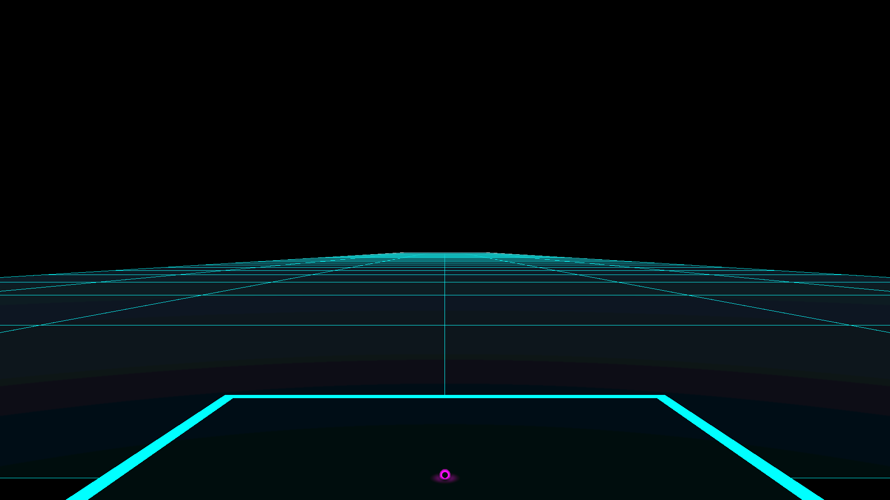
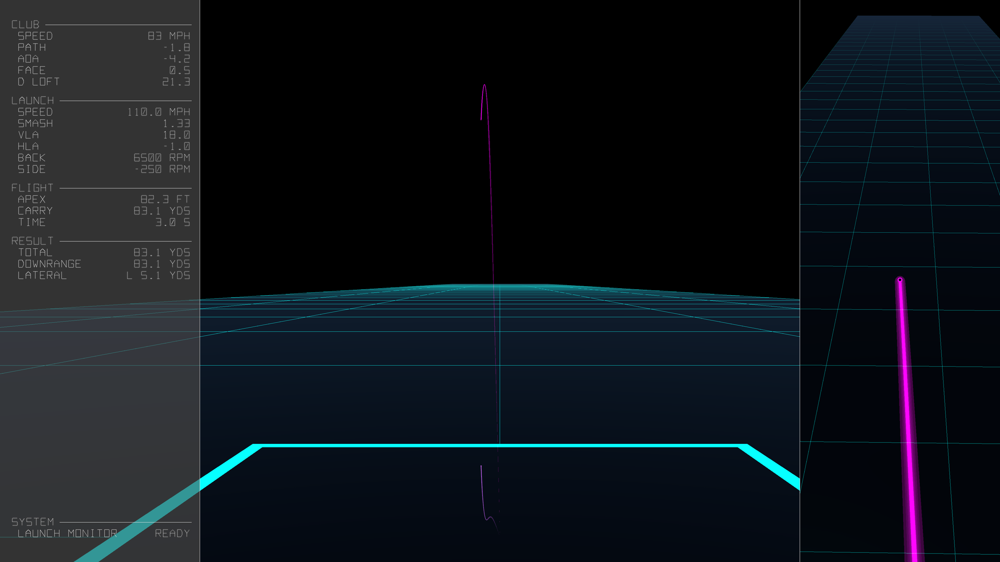
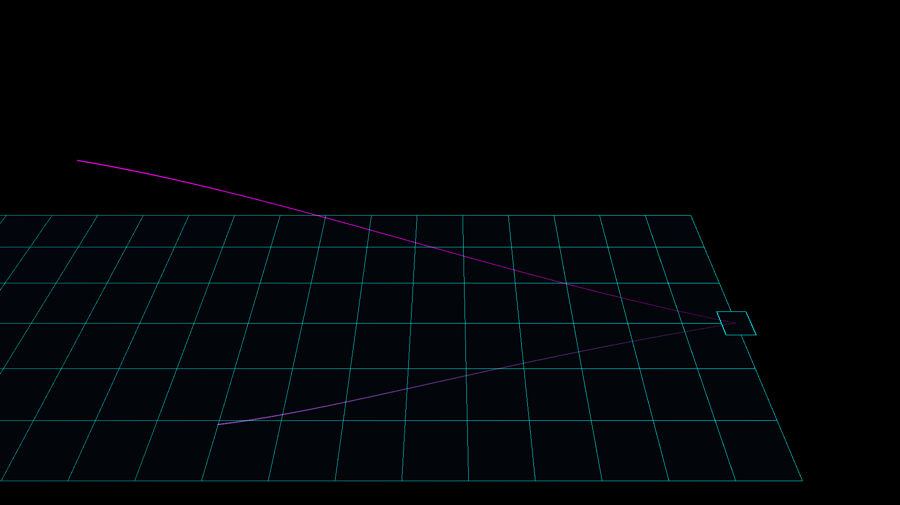

# cyberflight

A (very) digital driving range for golf simulators.

> **Early alpha**: in active development. Expect breaking changes, missing features, and rough edges.
> Ball flight comes from [dimple](https://github.com/divotmaker/dimple); its ground model
> (bounce and roll after landing, so run and total distance) is **beta** and not yet validated
> against measured data. See [docs/AERO.md](docs/AERO.md).
> The whole driving range plays as fairway. A putt with only a speed and a direction (no launch angle or spin) rolls
> from the tee on green. An optional circular green, drawn as one neon-green ring, is off
> by default; see [docs/AERO.md](docs/AERO.md) for how to enable it.







## Launch Monitor Integration

cyberflight receives live shot data from [flighthook](https://github.com/divotmaker/flighthook), an open-source golf automation bus. flighthook connects to your launch monitor and broadcasts shot data over a local WebSocket (the [Flight Relay Protocol](https://github.com/flightrelay/spec), FRP 0.3.0); cyberflight joins that bus as a collector (an actor that only listens, with a new actor id each run) to render ball flights in real time. It also connects to any other FRP launch monitor or hub with `--frp`.

The SYSTEM rows of the HUD list each launch monitor on the bus by name: READY when it reports no blockers, WAITING otherwise.

### Supported launch monitors

cyberflight works with any launch monitor flighthook supports. Today that includes the
FlightScope Mevo+, Mevo Gen2 and Xi, the Square Golf Omni and the Garmin R10, plus any monitor
that flighthook can bridge; see [flighthook's list](https://github.com/divotmaker/flighthook#supported-integrations) for the
current set and each device's status.

### Setup

1. Start flighthook and connect to your launch monitor
2. Start cyberflight — it connects to flighthook at `ws://127.0.0.1:5880/frp`; for
   flighthook on another machine, pass `--frp ws://<host>:5880/frp`. While
   flighthook is not running, or something accepts the connection but never
   answers, cyberflight retries every 5 s.
3. Send it

Shots are received in the background whatever is on screen, and each ball flies from the
moment its shot arrived: when drawing pauses (window hidden or minimized, display off), the
range picks up where it would have been, and shots that have finished meanwhile are not
replayed.

Everything cyberflight prints is also written to `cyberflight.log` next to the executable,
each line stamped with the local time (`HH:MM:SS.mmm`): connects, disconnects and why, each
shot's arrival, launch and stop. The file starts over at every launch.

## Running

```bash
cyberflight                         # borderless fullscreen, startup menu
cyberflight --windowed              # 1920x1080 window
cyberflight --range hole            # skip the menu: driving or hole
cyberflight --frp ws://pc:5880/frp  # flighthook on another machine
```

cyberflight opens with a menu over the driving range: pick the driving range or the hole
with the arrow keys and Enter. `--range driving` or `--range hole` skips the menu.

The hole is a straight 300 yd par 4 played from the tee: fairway, rough, bunkers, a pond,
rows of trees and a raised green with a cup and pin. Shots bounce and roll on its slopes,
stop in the water, under a tree or in the cup (a holed shot), and the HUD shows the distance
to the pin and the lie.

The ground reflects the tracer and the ball. On the driving range, a GPU that supports Vulkan
ray tracing starts with ray-traced reflections; otherwise (or after `R`) the reflections are
the tracer mirrored across the floor, which works on any Vulkan GPU and looks the same. On
the hole the reflections follow its slopes and are ray traced only: `R` turns them off and on,
and without ray tracing the hole draws no reflections.

| Key | Action |
|---|---|
| `Esc` | Quit |
| `↑` / `↓`, `Enter` | Pick a range in the startup menu |
| `R` | Driving range: switch the reflections between ray traced and mirrored (no ray tracing: mirrored only). Hole: switch them between ray traced and off (no ray tracing: none). The screen says which |
| `[` / `]` | Draw the tracer from more / fewer trajectory points |

On Linux, winit picks Wayland or X11; set `CYBERFLIGHT_X11=1` to force X11.

### Streaming

`--stream` renders headless (no window) and streams H.264 through
[ffmpeg](https://ffmpeg.org/), which must be on `PATH`. It draws the driving range, or the hole
with `--range hole`. Like the window, it draws ray-traced reflections when the GPU supports
Vulkan ray tracing; otherwise they are mirrored on the driving range and absent on the hole. It
uses NVENC when a test encode succeeds and libx264 otherwise.

```bash
cyberflight --stream                                # UDP to 127.0.0.1:5004
cyberflight --stream --mode hls --serve --port 8080 # HLS in stream/, served over HTTP
```

| Option | Values | Default |
|---|---|---|
| `--mode` | `udp` (low latency, e.g. `vlc --network-caching=100 udp://@127.0.0.1:5004`), `hls` (writes `stream/stream.m3u8`) | `udp` |
| `--preset` | `quality` (1080p60, 8 Mbit/s), `balanced` (720p60, 4 Mbit/s), `lite` (720p30, 2 Mbit/s) | `quality` |
| `--serve` | serve the HLS directory over HTTP on all interfaces (`http://<host>:<port>/stream.m3u8`) | off |
| `--port` | HTTP port for `--serve` | `8080` |

## Building

Requires Rust 1.94 or newer (edition 2024) and a Vulkan 1.3 driver. Ray tracing
needs `VK_KHR_ray_tracing_pipeline` and `VK_KHR_acceleration_structure`; it is optional (the
driving range's reflections are then mirrored, and the hole has none).

```bash
cargo build --release -p cyberflight          # target/release/cyberflight
cargo run --release -p cyberflight -- --windowed
cargo test --workspace                        # no GPU needed
cargo build --release -p cyberflight --target x86_64-pc-windows-gnu  # needs mingw-w64
```

Compiled SPIR-V shaders are checked in. After editing a shader in
`crates/cf-render/shaders/`, run `make shaders` (needs `glslc`).

### Screenshots

The `screenshot` example renders a fixed set of views headless (needs a Vulkan GPU): the hero
shot with chase camera and HUD, the empty range, a 7-iron from five views (one with the HUD;
the floor's reflections mirrored), ray-traced versions of the range and four of the 7-iron
views on GPUs that ray-trace, and two frames (in flight, then idle) through the calls
`--stream` makes, then the startup menu. On the hole it renders the tee from three cameras,
the green, a drive in flight and at rest, a holed drive, a shot in the water and one in the
trees, and on GPUs that ray-trace the tee, a drive over the fairway, over the pond and at the
green with ray-traced reflections, plus the drive with them off. `cf-test` compares two sets,
so a change can be checked for visual differences:

```bash
cargo run --release -p cyberflight --example screenshot -- --out before
# ...make a change...
cargo run --release -p cyberflight --example screenshot -- --out after
cargo run --release -p cf-test -- compare before after --diff diff
```

`compare` reports each image as byte-identical, pixel-identical, similar (SSIM at or above
`--ssim-min`, default 0.999) or FAIL, lists missing and extra files, writes amplified
difference images with `--diff`, and exits non-zero on any failure. Output depends on the
GPU and driver, so compare runs from the same machine.

## License

Licensed under either of [Apache License, Version 2.0](LICENSE-APACHE) or
[MIT license](LICENSE-MIT) at your option.

FlightScope, Mevo and Xi are trademarks of FlightScope (Pty) Ltd. Garmin and Approach R10 are
trademarks of Garmin Ltd. or its subsidiaries. Square Golf and Square Omni are trademarks of
Invant Inc. cyberflight is not affiliated with, endorsed by, or sponsored by any of these
companies.
