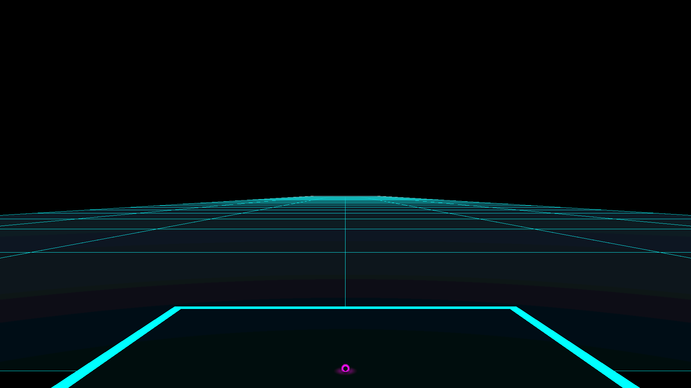

# cyberflight

A (very) digital driving range for golf simulators.

> **Early alpha**: in active development. Expect breaking changes, missing features, and rough edges.
> Ball flight comes from [dimple](https://github.com/divotmaker/dimple); its ground model
> (bounce and roll after landing, so run and total distance) is **beta** and not yet validated
> against measured data. See [docs/AERO.md](docs/AERO.md).
> The whole range plays as fairway; the orange target rings are aiming marks only.
> An optional circular green is off by default; see [docs/AERO.md](docs/AERO.md) for how to enable it.



## Launch Monitor Integration

cyberflight receives live shot data from [flighthook](https://github.com/divotmaker/flighthook), an open-source golf automation bus. flighthook connects to your launch monitor and broadcasts shot data over a local WebSocket (the [Flight Relay Protocol](https://github.com/flightrelay/spec)); cyberflight subscribes as a client to render ball flights in real time.

### Supported launch monitors

cyberflight works with any launch monitor flighthook supports. Today that includes the
FlightScope Mevo+, Mevo Gen2 and Xi, the Square Golf Omni, the Garmin R10 (alpha) and Uneekor
(alpha), plus any monitor that speaks GSPro Open Connect through flighthook's OpenConnect
server; see [flighthook's list](https://github.com/divotmaker/flighthook#supported-integrations) for the
current set and each device's status.

### Setup

1. Start flighthook and connect to your launch monitor
2. Start cyberflight — it connects to flighthook at `ws://localhost:5880/frp`; for
   flighthook on another machine, pass `--frp ws://<host>:5880/frp`. While
   flighthook is not running, cyberflight retries every 5 s. If something
   accepts the connection but never answers, cyberflight keeps waiting and
   logs a warning every 30 s; restart cyberflight to reconnect.
3. Send it

## Running

```bash
cyberflight                         # borderless fullscreen
cyberflight --windowed              # 1920x1080 window
cyberflight --frp ws://pc:5880/frp  # flighthook on another machine
```

With a GPU that supports Vulkan ray tracing, the window starts with ray-traced floor
reflections; otherwise it rasterizes.

| Key | Action |
|---|---|
| `Esc` | Quit |
| `R` | Toggle ray-traced reflections / rasterized (ray-tracing GPUs only) |
| `[` / `]` | Draw the tracer from more / fewer trajectory points |

On Linux, winit picks Wayland or X11; set `CYBERFLIGHT_X11=1` to force X11.

### Streaming

`--stream` renders headless (no window, no ray tracing) and streams H.264 through
[ffmpeg](https://ffmpeg.org/), which must be on `PATH`. It uses NVENC when a test encode
succeeds and libx264 otherwise.

```bash
cyberflight --stream                                # UDP to 127.0.0.1:5004
cyberflight --stream --mode hls --serve --port 8080 # HLS in stream/, served over HTTP
```

| Option | Values | Default |
|---|---|---|
| `--mode` | `udp` (low latency, e.g. `vlc --network-caching=100 udp://@127.0.0.1:5004`), `hls` (writes `stream/stream.m3u8`) | `udp` |
| `--preset` | `quality` (1080p60, 8 Mbit/s), `balanced` (720p60, 4 Mbit/s), `lite` (720p30, 2 Mbit/s) | `quality` |
| `--serve` | serve the HLS directory over HTTP on all interfaces (`http://<host>:<port>/stream.m3u8`) | off |
| `--port` | HTTP port for `--serve` | `8080` |

## Building

Requires a recent stable Rust toolchain (edition 2024) and a Vulkan 1.3 driver. Ray tracing
needs `VK_KHR_ray_tracing_pipeline` and `VK_KHR_acceleration_structure`; it is optional.

```bash
cargo build --release -p cyberflight          # target/release/cyberflight
cargo run --release -p cyberflight -- --windowed
cargo test --workspace                        # no GPU needed
cargo build --release -p cyberflight --target x86_64-pc-windows-gnu  # needs mingw-w64
```

Compiled SPIR-V shaders are checked in. After editing a shader in
`crates/cf-render/shaders/`, run `make shaders` (needs `glslc`).

### Screenshots

The `screenshot` example renders a fixed set of views headless (needs a Vulkan GPU), and
`cf-test` compares two sets, so a change can be checked for visual differences:

```bash
cargo run --release -p cyberflight --example screenshot -- --out before
# ...make a change...
cargo run --release -p cyberflight --example screenshot -- --out after
cargo run --release -p cf-test -- compare before after --diff diff
```

`compare` reports each image as byte-identical, pixel-identical, similar (SSIM at or above
`--ssim-min`, default 0.999) or FAIL, lists missing and extra files, writes amplified
difference images with `--diff`, and exits non-zero on any failure. Output depends on the
GPU and driver, so compare runs from the same machine.

## License

Licensed under either of [Apache License, Version 2.0](LICENSE-APACHE) or
[MIT license](LICENSE-MIT) at your option.

FlightScope, Mevo and Xi are trademarks of FlightScope (Pty) Ltd. Garmin and Approach R10 are
trademarks of Garmin Ltd. or its subsidiaries. Square Golf and Square Omni are trademarks of
Invant Inc. cyberflight is not affiliated with, endorsed by, or sponsored by any of these
companies.
